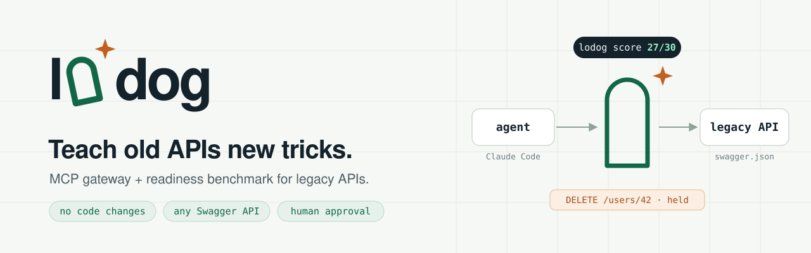
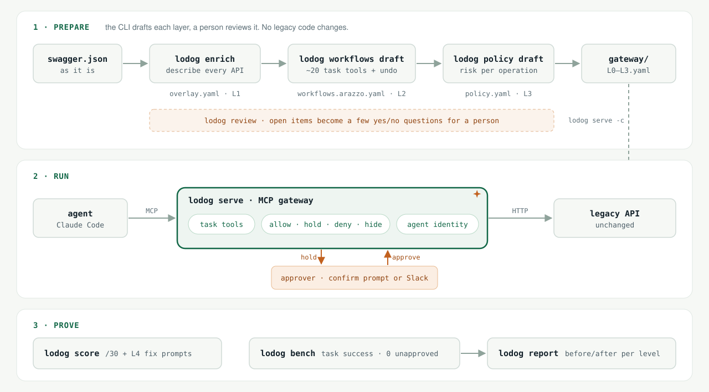

<p></p>

**English** · [繁體中文](README.zh-TW.md)

# lodog

> **Let agents run operations on legacy systems safely. No changes to the legacy code, any system with a Swagger/OpenAPI spec can plug in, and a score proves the agent can do the job and does it right.**

The problem, impact, principles and non-goals are in [docs/goal.md](docs/goal.md).

<p></p>

## Install

```
curl -fsSL https://raw.githubusercontent.com/iml885203/lodog/main/install.sh | sh
lodog skill install
```

Then tell Claude Code: *"Connect my system to lodog. The Swagger spec is at &lt;your swagger URL&gt;."* The onboarding skill runs each step and stops only for your decisions. The manual path is in [docs/getting-started.md](docs/getting-started.md).

## The name

**lodog = 老狗, "old dog"** (老 is pronounced *lou* in Cantonese).

The saying goes *you can't teach an old dog new tricks*. We disagree: **the legacy system is the old dog, and lodog teaches it new tricks**, so agents can operate it without changing a line of its code.

- **The old dog**: the legacy system. Its API stays as it is and still becomes something an agent can use.
- **The nose**: the readiness report, `lodog score`. It finds undocumented APIs and dangerous designs such as "reset a password with GET". The L4 section lists the fixes that need changes in the original code, each with a prompt you can paste straight into a coding agent.
- **The watchdog**: the gateway. It guards the legacy system's door, holds dangerous operations, and lets them through only after a human approves.
- **The logo**: the first o in lodog is a gate, with a spark beside it: the new trick the old dog learned. The gate is the gateway; the legacy system itself does not move.

## Docs

The docs are written in Traditional Chinese.

- [docs/goal.md](docs/goal.md): goal, problem, impact. Check a new issue against it before opening it
- [docs/scenarios.md](docs/scenarios.md): usage scenarios for owners, operators and approvers. People make the judgment calls; the CLI is for agents
- [docs/getting-started.md](docs/getting-started.md): Getting Started, from scoring your own system to connecting it to Claude Code; or run `lodog skill install` and let your own agent walk you through it
- [docs/init.md](docs/init.md): `lodog init` sets up a new system in your own repo
- [docs/approach.md](docs/approach.md): the approach and the agent-native format
- [docs/levels.md](docs/levels.md): levels and benchmark scores
- [docs/static-score.md](docs/static-score.md): the static score, where `lodog score` rates the docs alone out of 30
- [docs/approvals.md](docs/approvals.md): how approvals reach a person, either the user's confirmation prompt (default) or a Slack webhook link, with trade-offs and setup
- [docs/policy.md](docs/policy.md): how the L3 policy is produced: `lodog policy draft` drafts it, a person reviews it
- [docs/review.md](docs/review.md): review summaries, where `lodog review` turns a draft's open items into a few yes/no questions and writes the answers back
- [docs/benchmark.md](docs/benchmark.md): how the benchmark runs and is scored
- [docs/benchmark-flow.md](docs/benchmark-flow.md): benchmark architecture and flow diagrams
- [docs/benchmark-task-types.md](docs/benchmark-task-types.md): task types, task bank format, how to write tasks
- [docs/contracts.md](docs/contracts.md): formats between the three machines
- [docs/reference-isitagentready.md](docs/reference-isitagentready.md): notes on Is It Agent Ready and what L4 borrows from it

## Layout

- `cmd/`, `internal/`: the lodog CLI (Go)
- `docs/`: problem, impact, approach, interface contracts
- `cases/<system>/`: one case per legacy system, data only (version, environment, seed, task bank, answers), never that system's code. Examples: [anonymized backoffice fixture](cases/backoffice/) and [Keycloak](cases/keycloak/). The original services and real run records are not in this repo.

## Development

```
make tools && make hooks   # first time
make verify                # done means this passes
```

Requires Go 1.27 or later. Agent working rules are in [CLAUDE.md](CLAUDE.md); formats between the three machines are in [docs/contracts.md](docs/contracts.md).

## Releasing

Push a `vX.Y.Z` tag. The GitHub Actions `release` job uses goreleaser to build four binaries (darwin/linux × amd64/arm64) plus `checksums.txt` and creates a GitHub release. Users download from the release page without installing Go; `lodog --version` prints the tag.

```
git tag vX.Y.Z && git push origin vX.Y.Z
```

## Examples and verification

`cases/backoffice` is an anonymized offline regression fixture that keeps the API and workflow structure the tests need; no deployable original service is included. `cases/keycloak` uses a public API. Real environment settings, company cases, real benchmark records and the old Git history are not part of this release.

`make report-preview` builds the report page from synthetic fixtures. External acceptance tests need a compatible test service you provide yourself.
