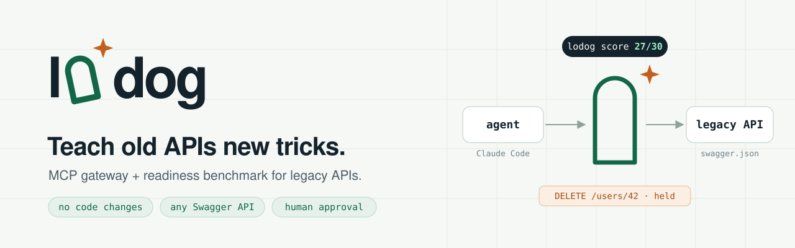
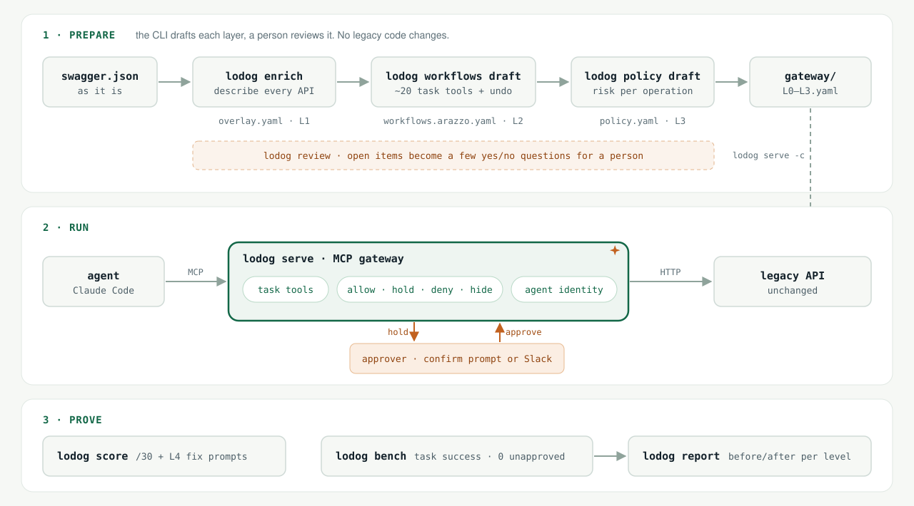

<p></p>

[English](README.md) · **繁體中文**

# lodog

> **讓 agent 能安全地在舊系統上做營運操作：不需要改舊系統的 code，任何有 swagger 的系統都接得上，而且能用分數證明 agent 做得到、做得對。**

問題、impact、原則和不做的事見 [docs/goal.md](docs/goal.md)。

<p></p>

## 安裝

```
curl -fsSL https://raw.githubusercontent.com/iml885203/lodog/main/install.sh | sh
lodog skill install
```

然後對 Claude Code 說：「幫我把這個系統接上 lodog，swagger 在 &lt;你的 swagger URL&gt;」。接入 skill 會自己跑每一步，只在需要你判斷時停下來。手動步驟見 [docs/getting-started.md](docs/getting-started.md)。

## 名字

**lodog = 老狗**（「老」粵語念 lou）。

俗話說 *you can't teach an old dog new tricks*，我們不同意：**舊系統就是那隻老狗，lodog 教它新把戲**，讓 agent 能操作它，原系統的 code 一行都不用改。

- **老狗**：舊系統。legacy API 不用改，就能變成 agent 用得了的樣子。
- **狗鼻子**：轉換報告，就是 `lodog score`：找出沒說明的 API，還有像「用 GET 重設密碼」這種危險設計；L4 段列出要改原系統 code 的項目，每項附可以直接貼給 coding agent 的修正指令。
- **看門狗**：gateway。守在舊系統門口，危險操作先擋下，等人核准才放行。
- **Logo**：lodog 的第一個 o 是一道門，旁邊一顆星：老狗學會的新把戲。門是 gateway，舊系統本身不動。

## 文件

- [docs/goal.md](docs/goal.md)：目標、問題、impact，開 issue 前先對照
- [docs/scenarios.md](docs/scenarios.md)：使用情境，owner、營運、核准人各自怎麼用，人只做判斷、CLI 交給 agent
- [docs/getting-started.md](docs/getting-started.md)：Getting Started，把自己的系統從量分數到接上 Claude Code；或 `lodog skill install` 裝上接入 skill，讓自己的 agent 帶著做
- [docs/init.md](docs/init.md)：`lodog init` 在你自己的 repo 開好接新系統的設定
- [docs/approach.md](docs/approach.md)：做法與 agent-native 格式
- [docs/levels.md](docs/levels.md)：分級與 benchmark 分數
- [docs/static-score.md](docs/static-score.md)：靜態分數，`lodog score` 只看文件評 30 分
- [docs/approvals.md](docs/approvals.md)：核准怎麼交給人：使用者的確認框（預設）或 Slack webhook 連結，兩種模式的取捨與設定
- [docs/policy.md](docs/policy.md)：L3 policy 怎麼產生，`lodog policy draft` 草擬、人工審核
- [docs/review.md](docs/review.md)：審核摘要，`lodog review` 把草稿的待審項目變成少數是非題、把回答寫回檔案
- [docs/benchmark.md](docs/benchmark.md)：benchmark 怎麼跑、怎麼評分
- [docs/benchmark-flow.md](docs/benchmark-flow.md)：benchmark 架構與流程圖
- [docs/benchmark-task-types.md](docs/benchmark-task-types.md)：題型與題庫格式、怎麼出題
- [docs/contracts.md](docs/contracts.md)：三台之間的格式
- [docs/reference-isitagentready.md](docs/reference-isitagentready.md)：參考 Is It Agent Ready，L4 要借用的做法

## 結構

- `cmd/`、`internal/`：lodog CLI（Go）
- `docs/`：problem、impact、做法、介面約定
- `cases/<system>/`：每個舊系統一個案例，只放資料（版本、環境、seed、題庫、答案），不放該系統的 code。範例為 [匿名後台測資](cases/backoffice/) 與 [Keycloak](cases/keycloak/)。原始服務與實際執行紀錄不包含在此 repo。

## 開發

```
make tools && make hooks   # 第一次
make verify                # 跑過才算完成
```

需要 Go 1.27 以上。agent 的工作規則見 [CLAUDE.md](CLAUDE.md)，三台之間的格式見 [docs/contracts.md](docs/contracts.md)。

## 發版

打 `vX.Y.Z` tag，GitHub Actions 的 `release` job 會用 goreleaser 打出 darwin/linux × amd64/arm64 四個執行檔和 `checksums.txt`，建立 GitHub release。使用者直接從 release 頁面下載，不用裝 Go；`lodog --version` 印出 tag。

```
git tag vX.Y.Z && git push origin vX.Y.Z
```

## 範例與驗證

`cases/backoffice` 是去識別化的離線回歸測資，保留測試需要的 API 與 workflow 結構；沒有附上可部署的原始服務。`cases/keycloak` 使用公開 API。實際環境設定、公司案例、實際 benchmark 紀錄與舊 Git 歷史均不隨此版本提供。

報告頁可用 `make report-preview` 從合成測資產生。外部 acceptance 測試需要自行準備相容的測試服務。
